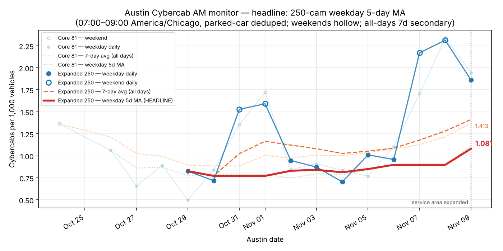

# Austin Cybercab tracker - 2026-11-09 (Mon)

Cybercabs per 1,000 vehicles seen on City of Austin traffic cameras, 07:00-09:00 America/Chicago, parked cars counted once. Relative growth only: not fleet size, not miles.

## Lead number

**Weekday 5-day average: 1.081**, +20.4% from 0.898 (250-camera panel; 11-03, 11-04, 11-05, 11-06, 11-09).

- Pooled over the same days: 1.075 (95% interval 0.945-1.218, 246 sightings).
- Without its highest day (11-09, 1.861): 0.886. Median day: 0.958.
- All-days 7-day average (secondary): 1.413.

## This morning

| Panel | Per 1,000 vehicles | 95% interval | Sightings | Vehicles | Cameras with a sighting | Cameras reporting | Cycles |
| --- | ---: | ---: | ---: | ---: | ---: | ---: | ---: |
| Expanded 250 (headline) | 1.861 | 1.484-2.304 | 84 | 45,148 | 63 | 240/250 | 22 |
| Core 81 (legacy) | 1.945 |  | 36 | 18,510 | n/a | 79/81 | 22 |
| New area 98 (context) | no data | | | | | | |

Headline panel day change: -19.5% vs 11-08; +94.3% vs the previous weekday (11-06).

_Service area: Tesla expanded the Austin service area on 2026-11-09. The headline and core panels cover the original area only; the new-area panel is every City camera outside it and is never blended into the headline._

## What moved

Baseline = previous 5 weekdays (2026-11-02 to 2026-11-06). Counts are parked-car-deduped sightings, not unique cars.

### 1. What moved

| | Baseline (per day) | 2026-11-09 | Change |
| --- | ---: | ---: | ---: |
| Cybercabs per 1,000 vehicles | 0.897 | 1.861 | +107% |
| Sightings | 43.0 | 84 | +95% |
| Vehicles counted | 47,930 | 45,148 | -6% |
| Cameras reporting | 241 | 240 | |
| Cameras with a sighting (spread) | 36.0 | 63 | +75% |
| Sightings per such camera (density) | 1.19 | 1.33 | +12% |

95% interval on the day's rate: 1.484-2.304; on the baseline: 0.781-1.025. The intervals do not overlap, so the change is larger than counting noise.
Of the change in sightings, about 84% is spread (more cameras seeing one) and 16% is density (more per camera).

### 2. Same cameras only

233 cameras reported on every one of these days. On those alone the rate went 0.883 -> 1.835 (+108%), against +107% on the full panel. Camera mix is not driving the change.

### 3. Concentration

Top 10 cameras hold 32% of the day's sightings. 24 of the 63 cameras with a sighting had none in the baseline.

| Camera | Location | Sightings | Baseline per day |
| --- | --- | ---: | ---: |
| 563 | COLORADO ST / 2ND ST | 5 | 0.2 |
| 132 | 6TH ST / LAVACA ST | 4 | 0.0 |
| 131 | 7TH ST / SAN JACINTO BLVD | 3 | 0.0 |
| 674 | CESAR CHAVEZ ST / 35 SVRD | 3 | 0.2 |
| 1500 | 1ST ST / LIGHTSEY RD | 2 | 0.0 |
| 181 | US 183 HWY / BURLESON RD | 2 | 0.2 |
| 217 | MARTIN LUTHER KING JR BLVD / SPRINGDALE RD | 2 | 0.2 |
| 254 | BRAKER LN / RESEARCH BLVD SVRD | 2 | 0.8 |

### 4. Where

| Distance from downtown | Cameras | Baseline rate | 2026-11-09 rate | Change | Sightings |
| --- | ---: | ---: | ---: | ---: | ---: |
| 0-3 km (downtown) | 85 | 1.085 | 3.512 | +224% | 43 |
| 3-8 km | 74 | 0.933 | 2.006 | +115% | 28 |
| 8+ km (edge of original area) | 91 | 0.729 | 0.686 | -6% | 13 |

| Corridor | Cameras | Baseline rate | 2026-11-09 rate | Sightings (baseline per day -> day) |
| --- | ---: | ---: | ---: | ---: |
| Other | 109 | 0.761 | 1.991 | 13.2 -> 35 |
| Cesar Chavez | 11 | 1.261 | 5.236 | 2.6 -> 8 |
| Lamar | 29 | 1.119 | 1.380 | 6.0 -> 7 |
| Guadalupe | 8 | 2.183 | 5.414 | 2.8 -> 7 |
| I-35 | 20 | 1.047 | 1.804 | 4.6 -> 7 |
| Riverside | 10 | 1.308 | 3.119 | 3.2 -> 6 |
| Burnet | 16 | 1.051 | 1.255 | 3.6 -> 4 |
| Airport Blvd | 13 | 0.568 | 1.486 | 1.6 -> 4 |
| Congress | 7 | 0.757 | 2.285 | 1.2 -> 3 |
| US-183 | 6 | 2.720 | 2.387 | 3.0 -> 2 |
| Ben White / SH-71 | 6 | 0.000 | 1.131 | 0.0 -> 1 |
| MoPac | 8 | 0.370 | 0.000 | 0.8 -> 0 |
| Parmer | 7 | 0.145 | 0.000 | 0.4 -> 0 |

_Corridor and band cells rest on a handful of sightings each; read them as direction, not size._

### 5. New service area (outside the original boundary)

4 sightings at 2 of 90 reporting cameras, 12,594 vehicles (0.318 per 1,000).

Old and new area together: 1.524 per 1,000 vehicles (88 sightings). Context only; the headline stays on the original-area panel.

## Chart

_Generated 2026-11-10 00:55 UTC by the daily GitHub job._
