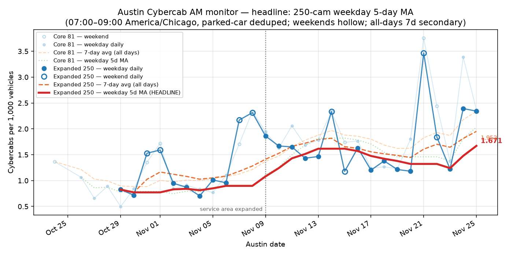

# Austin Cybercab tracker - 2026-11-23 (Mon)

Cybercabs per 1,000 vehicles seen on City of Austin traffic cameras, 07:00-09:00 America/Chicago, parked cars counted once. Relative growth only: not fleet size, not miles.

## Lead number

**Weekday 5-day average: 1.240**, -6.2% from 1.322 (250-camera panel; 11-17, 11-18, 11-19, 11-20, 11-23).

- Pooled over the same days: 1.242 (95% interval 1.092-1.407, 247 sightings).
- Without its highest day (11-18, 1.380): 1.205. Median day: 1.214.
- Against the five weekdays before those: -21.0% (was 1.570).
- All-days 7-day average (secondary): 1.644.

## This morning

| Panel | Per 1,000 vehicles | 95% interval | Sightings | Vehicles | Cameras with a sighting | Cameras reporting | Cycles |
| --- | ---: | ---: | ---: | ---: | ---: | ---: | ---: |
| Expanded 250 (headline) | 1.223 | 0.878-1.659 | 41 | 33,521 | 31 | 238/250 | 24 |
| Core 81 (legacy) | 1.371 | 0.825-2.141 | 19 | 13,857 | 14 | 78/81 | 24 |
| New area 98 (context) | 0.749 | 0.201-1.917 | 4 | 5,343 | 4 | 73/98 | 24 |

Headline panel day change: -33.6% vs 11-22; +3.6% vs the previous weekday (11-20).
Offline headline cameras: 1080,1461,254,269,40,496,500,544,572,703,714,716.

_Service area: Tesla expanded the Austin service area on 2026-11-09. The headline and core panels cover the original area only; the new-area panel is every City camera outside it and is never blended into the headline._

## What moved

Baseline = previous 5 weekdays (2026-11-16 to 2026-11-20). Counts are parked-car-deduped sightings, not unique cars.

### 1. What moved

| | Baseline (per day) | 2026-11-23 | Change |
| --- | ---: | ---: | ---: |
| Cybercabs per 1,000 vehicles | 1.334 | 1.223 | -8% |
| Sightings | 57.2 | 41 | -28% |
| Vehicles counted | 42,877 | 33,521 | -22% |
| Cameras reporting | 232 | 238 | |
| Cameras with a sighting (spread) | 41.4 | 31 | -25% |
| Sightings per such camera (density) | 1.38 | 1.32 | -4% |

95% interval on the day's rate: 0.878-1.659; on the baseline: 1.184-1.498. The intervals overlap, so the change is within counting noise.
Of the change in sightings, about 87% is spread (more cameras seeing one) and 13% is density (more per camera).

### 2. Same cameras only

222 cameras reported on every one of these days. On those alone the rate went 1.356 -> 1.187 (-12%), against -8% on the full panel. Camera mix is not driving the change.

### 3. Concentration

Top 10 cameras hold 49% of the day's sightings. 3 of the 31 cameras with a sighting had none in the baseline.

| Camera | Location | Sightings | Baseline per day |
| --- | --- | ---: | ---: |
| 674 | CESAR CHAVEZ ST / 35 SVRD | 4 | 1.4 |
| 786 | CESAR CHAVEZ ST / SAN JACINTO BLVD | 3 | 0.4 |
| 332 | CAMERON RD / 290 HWY SVRD | 2 | 0.2 |
| 351 | 6TH ST / GUADALUPE ST | 2 | 4.2 |
| 354 | 5TH ST / CONGRESS AVE | 2 | 0.6 |
| 371 | PLEASANT VALLEY RD / STASSNEY LN | 2 | 0.2 |
| 61 | GUADALUPE ST / MARTIN LUTHER KING JR BLVD | 2 | 1.2 |
| 100 | LAMAR BLVD / BARTON SPRINGS RD | 1 | 1.2 |

### 4. Where

| Distance from downtown | Cameras | Baseline rate | 2026-11-23 rate | Change | Sightings |
| --- | ---: | ---: | ---: | ---: | ---: |
| 0-3 km (downtown) | 85 | 2.474 | 2.452 | -1% | 25 |
| 3-8 km | 74 | 1.244 | 0.711 | -43% | 8 |
| 8+ km (edge of original area) | 91 | 0.570 | 0.663 | +16% | 8 |

| Corridor | Cameras | Baseline rate | 2026-11-23 rate | Sightings (baseline per day -> day) |
| --- | ---: | ---: | ---: | ---: |
| Other | 109 | 1.138 | 1.190 | 18.0 -> 15 |
| I-35 | 20 | 1.975 | 2.020 | 7.0 -> 6 |
| Guadalupe | 8 | 5.384 | 4.496 | 7.6 -> 5 |
| Lamar | 29 | 1.653 | 1.024 | 8.2 -> 4 |
| Cesar Chavez | 11 | 2.706 | 3.472 | 5.0 -> 4 |
| Riverside | 10 | 1.765 | 1.440 | 3.2 -> 2 |
| Congress | 7 | 1.255 | 1.571 | 2.0 -> 2 |
| Burnet | 16 | 1.023 | 0.465 | 2.8 -> 1 |
| Airport Blvd | 13 | 0.871 | 0.385 | 2.4 -> 1 |
| Parmer | 7 | 0.177 | 0.943 | 0.4 -> 1 |
| MoPac | 8 | 0.000 | 0.000 | 0.0 -> 0 |
| Ben White / SH-71 | 6 | 0.217 | 0.000 | 0.2 -> 0 |
| US-183 | 6 | 0.456 | 0.000 | 0.4 -> 0 |

_Corridor and band cells rest on a handful of sightings each; read them as direction, not size._

### 5. New service area (outside the original boundary)

4 sightings at 4 of 73 reporting cameras, 5,343 vehicles (0.749 per 1,000). Previous 5 weekdays: 3.4 sightings and 3.2 cameras per day.

Old and new area together: 1.158 per 1,000 vehicles (45 sightings). Context only; the headline stays on the original-area panel.

## Chart

_Generated 2026-11-23 15:57 UTC by the daily GitHub job._
